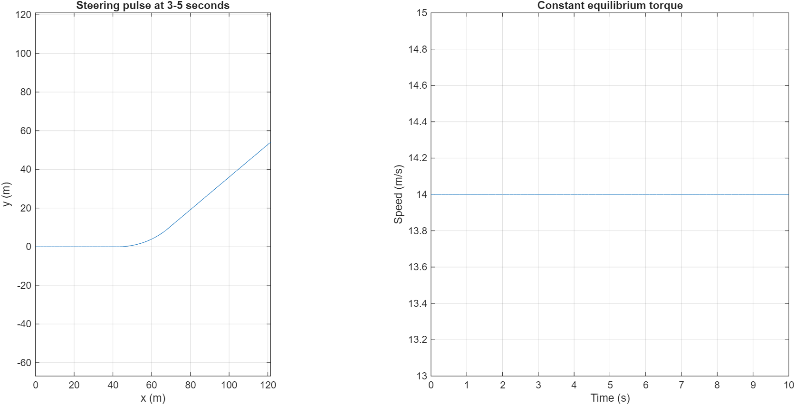
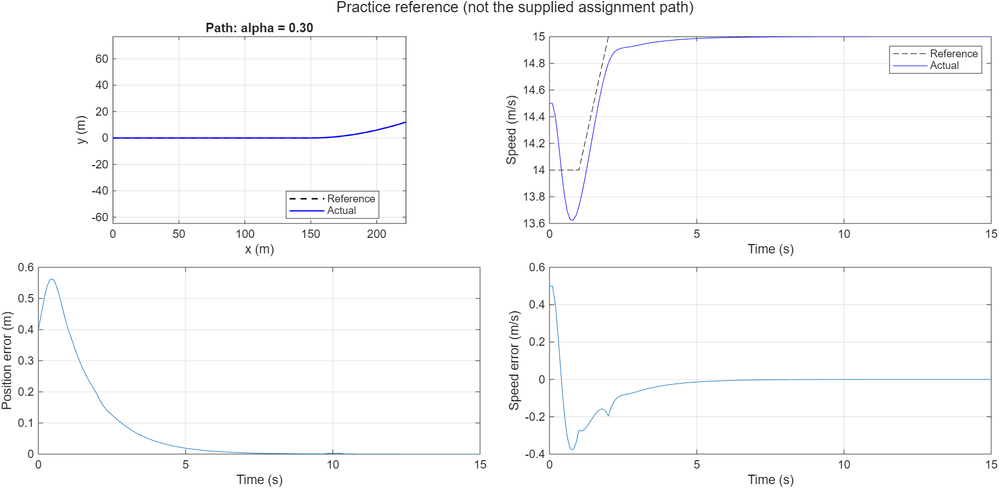
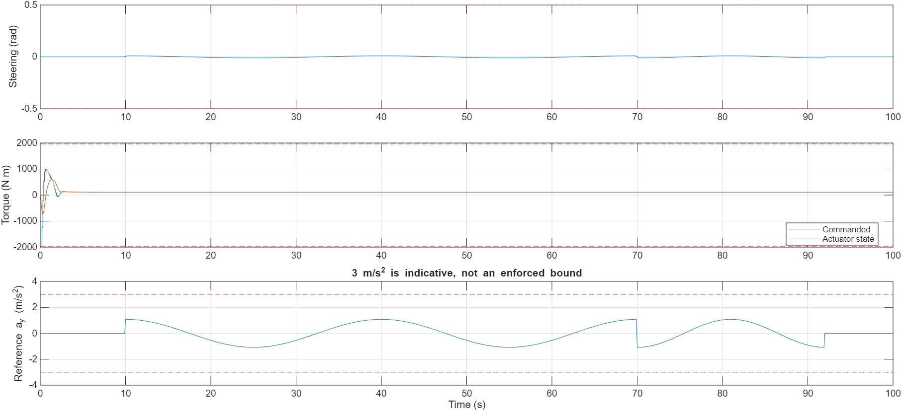
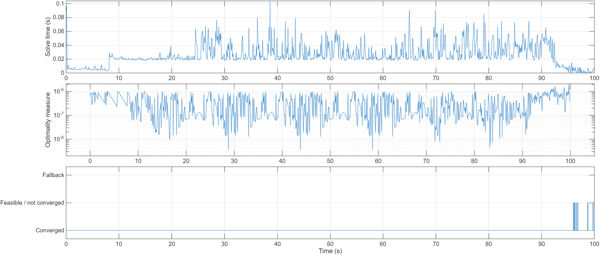
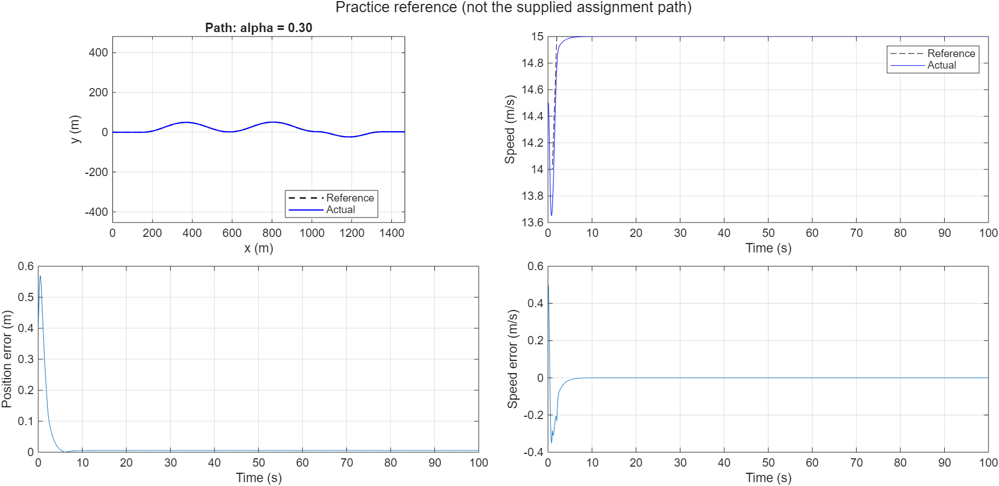
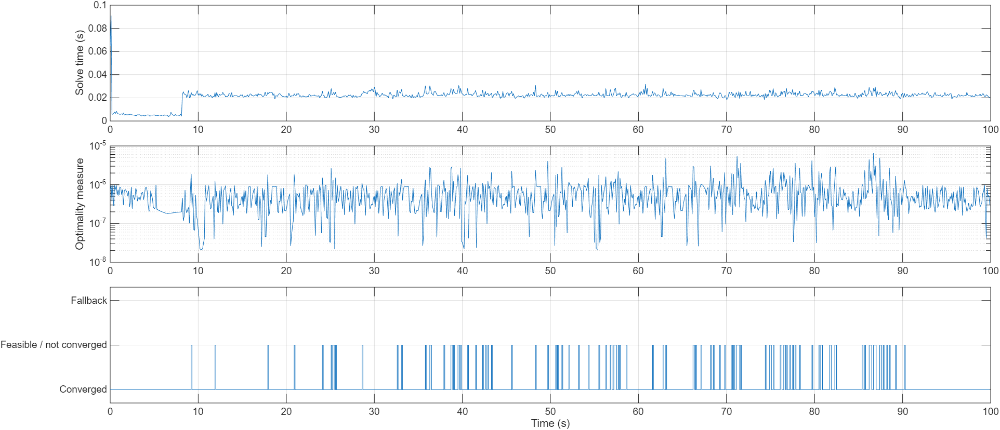
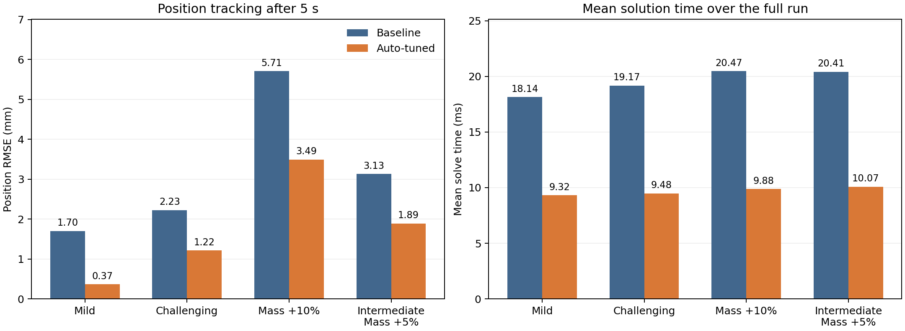

# Nonlinear Model Predictive Control for Vehicle Path Tracking in MATLAB

This report develops a vehicle path-tracking controller from its mathematical model to a working MATLAB implementation. The derivation is organized into numbered steps. Each mathematical operation is followed by the corresponding MATLAB code, with links to the complete functions.

The controller uses single shooting, analytical adjoint gradients, a custom projected BFGS optimizer, warm starts, and explicit fallback logic. An offline search then selects the prediction horizon and cost weights from closed-loop performance.

**Scope and reference path.** This project addresses the mathematical-model portion of Question 1 of `NMPC_HW1.pdf`. The original reference-generation source was not supplied. Consequently, all reported experiments use the explicitly defined **practice reference** in this repository. The neural-network portion of Question 2 is outside this implementation.

**Reported result.** Trial 16 of an 18-candidate search selected a 15-step horizon. In four 100-second validation scenarios, the reported position RMSE after 5 seconds decreased by approximately 39–78%, and mean solution time decreased by approximately half. The numerical tables document the supplied MATLAB outputs; they do not represent a new execution during report preparation.

## Numbered workflow

1. [Define the tracking problem and notation](#step-01)
2. [Set physical parameters and baseline configuration](#step-02)
3. [Calculate equilibrium torque and initial conditions](#step-03)
4. [Derive the planar position update](#step-04)
5. [Derive the longitudinal speed update](#step-05)
6. [Derive heading and actuator dynamics](#step-06)
7. [Assemble and check the complete discrete model](#step-07)
8. [Define the practice reference yaw rate](#step-08)
9. [Integrate the reference and include horizon padding](#step-09)
10. [Normalize the commands and express the bounds](#step-10)
11. [Roll out predicted states by single shooting](#step-11)
12. [Define the input reference and tracking errors](#step-12)
13. [Construct the complete NMPC cost](#step-13)
14. [Differentiate the model with respect to the state](#step-14)
15. [Differentiate the model with respect to the commands](#step-15)
16. [Differentiate the direct command penalties](#step-16)
17. [Derive the adjoint gradient of the tracking penalties](#step-17)
18. [Check the analytical derivatives numerically](#step-18)
19. [Define projection and constrained stationarity](#step-19)
20. [Choose a feasible search direction](#step-20)
21. [Perform projected Armijo backtracking](#step-21)
22. [Update the inverse Hessian with BFGS](#step-22)
23. [Separate convergence from numerical stagnation](#step-23)
24. [Warm-start the next optimization](#step-24)
25. [Accept a candidate or use the warm-start fallback](#step-25)
26. [Close the loop around the simulated plant](#step-26)
27. [Compute the performance metrics precisely](#step-27)
28. [Run and interpret the baseline experiments](#step-28)
29. [Define the automatic tuning variables](#step-29)
30. [Build a fixed outer performance score](#step-30)
31. [Explore candidates and refine the best setting](#step-31)
32. [Score each candidate across training scenarios](#step-32)
33. [Validate the candidate and apply an acceptance gate](#step-33)
34. [Present the selected parameters and paired results](#step-34)
35. [Reproduce the workflow and reuse saved settings](#step-35)
36. [Locate the source code and generated outputs](#step-36)
37. [State verification scope, limitations, and references](#step-37)

<a id="step-01"></a>
## Step 1 — Define the tracking problem and notation

The five states are planar position, longitudinal speed, heading, and actual actuator torque. The two commands are requested torque and steering angle:

```math
x_k=
\begin{bmatrix}
p_{x,k}\\p_{y,k}\\v_k\\\varphi_k\\T_k
\end{bmatrix}\in\mathbb R^5,
\qquad
u_k=
\begin{bmatrix}T_{u,k}\\\delta_k\end{bmatrix}\in\mathbb R^2.
```

The tracked output contains position and speed:

```math
y_k=Cx_k,\qquad
C=\begin{bmatrix}
1&0&0&0&0\\
0&1&0&0&0\\
0&0&1&0&0
\end{bmatrix}.
```

**MATLAB — state and output ordering**

```matlab
% x = [px; py; v; phi; T]
% u = [Tu; delta]
C = [eye(3), zeros(3,2)];
y = C*x;
% The implementation uses the equivalent indexing:
y = x(1:3);
```

| Symbol | Meaning | Unit |
|---|---|---|
| `px, py` | Global planar position | m |
| `v` | Forward speed | m/s |
| `phi` | Unwrapped heading angle | rad |
| `T` | Actual actuator torque | N·m |
| `Tu` | Commanded actuator torque | N·m |
| `delta` | Steering angle | rad |
| `dt` | Sampling interval | s |
| `Np` | Number of prediction steps | — |

At each sampling instant all five states are assumed available without measurement noise. The reference is tracked directly; no following-distance offset is introduced. The nominal prediction model stays unchanged during the plant-mass uncertainty experiment.

The notation `x_(j|k)` means the state predicted `j` steps ahead from sampling instant `k`. For compact derivations within one optimization, `x_j` and `z_j` denote these predicted states and normalized inputs.

<a id="step-02"></a>
## Step 2 — Set physical parameters and baseline configuration

| Parameter | Value | Unit |
|---|---:|---|
| Mass, `m` | 1270 | kg |
| Effective wheel radius, `R` | 0.3036 | m |
| Quadratic resistance coefficient, `CA` | 0.9871 | kg/m |
| Actuator time constant, `tau` | 0.5107 | s |
| Transmission efficiency, `eta` | 0.96 | — |
| Rolling resistance coefficient, `fr` | 0.01 | — |
| Gravitational acceleration, `g` | 9.8 | m/s² |
| Wheelbase, `L` | 2 | m |

The baseline sampling interval and horizon give:

```math
\Delta t=0.1\ {\rm s},\qquad N_p=20,\qquad
T_h=N_p\Delta t=2\ {\rm s},\qquad
K=\frac{100}{0.1}=1000.
```

**MATLAB — [nmpc_config.m](nmpc_config.m)**

```matlab
cfg.dt = 0.1;
cfg.Tsim = 100;
cfg.Np = 20;
cfg.alpha = 0.30;
cfg.Q = diag([2 2 3]);
cfg.P = diag([8 8 6]);
cfg.R = diag([0.2 0.3]);
cfg.S = diag([0.3 3]);
cfg.inputScale = [1965.1; 0.5];
cfg.p = struct('m',1270,'R',0.3036,'CA',0.9871, ...
    'tau',0.5107,'eta',0.96,'fr',0.01,'g',9.8,'L',2);
```

The physical wheel radius is `cfg.p.R`. The input-cost matrix is `cfg.R`; these are distinct quantities despite the shared letter.

<a id="step-03"></a>
## Step 3 — Calculate equilibrium torque and initial conditions

At constant speed the drive force balances aerodynamic and rolling resistance:

```math
F_{\rm drive}=\frac{\eta T}{R},\qquad
F_{\rm resistance}=C_Av^2+mgf_r,
```

```math
\dot v=0
\ \Longrightarrow\
\frac{\eta T_{\rm eq}}{R}=C_Av^2+mgf_r
\ \Longrightarrow\
T_{\rm eq}(v)=\frac{R}{\eta}(C_Av^2+mgf_r).
```

**MATLAB — [equilibrium_torque.m](equilibrium_torque.m)**

```matlab
function T = equilibrium_torque(v,p)
%EQUILIBRIUM_TORQUE Torque balancing the resistance at forward speed v.
T = (p.R/p.eta)*(p.CA*v.^2 + p.m*p.g*p.fr);
end
```

Numerically:

```math
T_{\rm eq}(14.5)=104.99429634375\ {\rm N\,m},\qquad
T_{\rm eq}(15)=109.598809375\ {\rm N\,m}.
```

The initial actual state and previous physical command are:

```math
x_0=\begin{bmatrix}0.4&0&14.5&0&T_{\rm eq}(14.5)\end{bmatrix}^{\mathsf T},
\qquad
u_{-1}=\begin{bmatrix}T_{\rm eq}(14.5)&0\end{bmatrix}^{\mathsf T}.
```

**MATLAB — initialization in [simulate_nmpc.m](simulate_nmpc.m)**

```matlab
T0 = equilibrium_torque(14.5,cfg.p);
X(:,1) = [0.4;0;14.5;0;T0];
zprev = [T0;0]./cfg.inputScale;
warm = repmat(zprev,1,N);
```

The reference starts at `[px;py;v;phi] = [0;0;14;0]`. Thus the simulation deliberately starts with nonzero position and speed errors.

<a id="step-04"></a>
## Step 4 — Derive the planar position update

### 4.1 Resolve forward speed into global coordinates

With the velocity aligned with the heading:

```math
\dot p_x=v\cos\varphi,\qquad
\dot p_y=v\sin\varphi.
```

Forward Euler evaluates the right-hand side at the current state:

```math
p_{x,k+1}=p_{x,k}+\Delta t\,v_k\cos\varphi_k,\qquad
p_{y,k+1}=p_{y,k}+\Delta t\,v_k\sin\varphi_k.
```

**MATLAB — position rows of [vehicle_step.m](vehicle_step.m)**

```matlab
pxNext = x(1) + dt*v*cos(phi);
pyNext = x(2) + dt*v*sin(phi);
```

These named scalar expressions explain the corresponding rows of `xn` in the complete function in Step 7.

### 4.2 Check the units

```math
[\Delta t\,v\cos\varphi]={\rm s}\times{\rm m/s}={\rm m}.
```

**MATLAB — a simple numerical check**

```matlab
dt = 0.1; v = 14.5; phi = 0;
displacement = dt*v*[cos(phi);sin(phi)];
% displacement = [1.45; 0] m
```

<a id="step-05"></a>
## Step 5 — Derive the longitudinal speed update

### 5.1 Apply Newton's second law

```math
m\dot v=\frac{\eta T}{R}-C_Av^2-mgf_r.
```

Dividing by mass and applying forward Euler gives:

```math
\begin{aligned}
v_{k+1}
&=v_k+\Delta t\left(\frac{\eta T_k}{mR}
-\frac{C_Av_k^2}{m}-gf_r\right)\\
&=v_k+\frac{\eta\Delta t}{mR}
\left[T_k-\frac{R}{\eta}(C_Av_k^2+mgf_r)\right].
\end{aligned}
```

**MATLAB — speed row of [vehicle_step.m](vehicle_step.m)**

```matlab
F = p.CA*v^2 + p.m*p.g*p.fr;
vNext = v + p.eta*dt/(p.m*p.R)*(T - p.R/p.eta*F);
```

The symbol `F` in the source is the resistance force. The speed equation uses the **current actual torque** `T`. It does not use the newly commanded torque directly.

### 5.2 Verify equilibrium

Substituting the result of Step 3:

```math
T_k=T_{\rm eq}(v_k)
\ \Longrightarrow\
v_{k+1}-v_k=0.
```

**MATLAB — equilibrium model check**

```matlab
cfg = nmpc_config();
v0 = 14.5;
T0 = equilibrium_torque(v0,cfg.p);
x0 = [0;0;v0;0;T0];
x1 = vehicle_step(x0,[T0;0],cfg.p,cfg.dt);
assert(abs(x1(3)-v0) < 1e-10);
```

<a id="step-06"></a>
## Step 6 — Derive heading and actuator dynamics

### 6.1 Kinematic bicycle heading

For wheelbase `L` and steering angle `delta`:

```math
\dot\varphi=\frac{v}{L}\tan\delta
\ \Longrightarrow\
\varphi_{k+1}=\varphi_k+\Delta t\,\frac{v_k}{L}\tan\delta_k.
```

**MATLAB — heading row**

```matlab
phiNext = phi + dt*v/p.L*tan(delta);
```

The stored heading is unwrapped. Setting steering back to zero stops further heading rotation; it does not reset the heading to zero.

### 6.2 First-order torque actuator

```math
\tau\dot T+T=T_u
\ \Longrightarrow\
\dot T=\frac{T_u-T}{\tau}
\ \Longrightarrow\
T_{k+1}=\left(1-\frac{\Delta t}{\tau}\right)T_k
+\frac{\Delta t}{\tau}T_{u,k}.
```

**MATLAB — actuator row**

```matlab
TNext = T + dt/p.tau*(u(1)-T);
```

The direct effects are therefore:

```math
\frac{\partial T_{k+1}}{\partial T_{u,k}}=\frac{\Delta t}{\tau},
\qquad
\frac{\partial v_{k+1}}{\partial T_{u,k}}=0.
```

**MATLAB — demonstrate the actuator delay**

```matlab
cfg = nmpc_config();
T0 = equilibrium_torque(14.5,cfg.p);
x = [0;0;14.5;0;T0];
a = vehicle_step(x,[0;0],cfg.p,cfg.dt);
b = vehicle_step(x,[1000;0],cfg.p,cfg.dt);
assert(abs(a(3)-b(3)) < 1e-12);
assert(b(5) > a(5));
```

<a id="step-07"></a>
## Step 7 — Assemble and check the complete discrete model

Collecting the preceding equations:

```math
x_{k+1}=f_d(x_k,u_k)=
\begin{bmatrix}
p_{x,k}+\Delta t\,v_k\cos\varphi_k\\
p_{y,k}+\Delta t\,v_k\sin\varphi_k\\
v_k+\frac{\eta\Delta t}{mR}
\left[T_k-\frac{R}{\eta}(C_Av_k^2+mgf_r)\right]\\
\varphi_k+\frac{\Delta t\,v_k}{L}\tan\delta_k\\
T_k+\frac{\Delta t}{\tau}(T_{u,k}-T_k)
\end{bmatrix}.
```

**MATLAB — complete [vehicle_step.m](vehicle_step.m), including the Jacobians derived in Steps 14–15**

```matlab
function [xn,A,B] = vehicle_step(x,u,p,dt)
%VEHICLE_STEP Exact discrete mapping from Eq. (2); no ODE integrator.
% All right-hand sides use OLD states. Do not update x in place.
% A = d(x_next)/dx; B = d(x_next)/d(physical input).
x = x(:); u = u(:);
v = x(3); phi = x(4); T = x(5);
delta = u(2);
F = p.CA*v^2 + p.m*p.g*p.fr;
xn = [x(1) + dt*v*cos(phi); ...
      x(2) + dt*v*sin(phi); ...
      v + p.eta*dt/(p.m*p.R)*(T - p.R/p.eta*F); ...
      phi + dt*v/p.L*tan(delta); ...
      T + dt/p.tau*(u(1)-T)];
% Heading remains unwrapped. Speed is not clipped or artificially repaired.
if nargout > 1
    A = eye(5);
    A(1,3) = dt*cos(phi); A(1,4) = -dt*v*sin(phi);
    A(2,3) = dt*sin(phi); A(2,4) = dt*v*cos(phi);
    A(3,3) = 1 - 2*dt*p.CA*v/p.m;
    A(3,5) = p.eta*dt/(p.m*p.R);
    A(4,3) = dt/p.L*tan(delta);
    A(5,5) = 1 - dt/p.tau;
    B = zeros(5,2);
    B(4,2) = dt*v/(p.L*cos(delta)^2);
    B(5,1) = dt/p.tau;
end
end
```

Both the prediction model and simulated plant use this discrete mapping. All right-hand sides use old states. The implementation does not wrap heading or clip speed. An actual rollout leaving the positive-speed, finite-state domain is terminated and recorded.

### 7.1 Work through one numerical step

For the initial state and an equilibrium command:

```math
\begin{aligned}
p_{x,1}&=0.4+0.1(14.5)\cos0=1.85\ {\rm m},\\
p_{y,1}&=0,\quad v_1=14.5\ {\rm m/s},\\
\varphi_1&=0,\quad T_1=104.99429634375\ {\rm N\,m}.
\end{aligned}
```

The reference at `t=0.1` is `[1.4;0;14]`. Therefore:

```math
e_1=y_1-y_1^{\rm ref}
=\begin{bmatrix}1.85-1.4\\0\\14.5-14\end{bmatrix}
=\begin{bmatrix}0.45\\0\\0.5\end{bmatrix}.
```

**MATLAB — reproduce the hand calculation**

```matlab
cfg = nmpc_config();
T0 = equilibrium_torque(14.5,cfg.p);
x0 = [0.4;0;14.5;0;T0];
x1 = vehicle_step(x0,[T0;0],cfg.p,cfg.dt);
e1 = x1(1:3)-[1.4;0;14];
assert(norm(e1-[0.45;0;0.5],inf) < 1e-10);
```

This is a hand-check with a selected equilibrium command, not a newly measured controller trajectory.

### 7.2 Run the open-loop check

The demo holds equilibrium torque at 14 m/s and applies a 0.05-rad steering pulse from 3 to 5 seconds.

**MATLAB — [demo_open_loop.m](demo_open_loop.m)**

```matlab
demo_open_loop
```



<a id="step-08"></a>
## Step 8 — Define the practice reference yaw rate

The chosen base yaw rate is:

```math
r_b(t)=
\begin{cases}
0,&0\le t<10,\\
0.24\cos\left(\frac{2\pi(t-10)}{30}\right),&10\le t<70,\\
-0.24\cos\left(\frac{2\pi(t-70)}{22}\right),&70\le t<92,\\
0,&t\ge92.
\end{cases}
```

**MATLAB — [practice_yaw_rate.m](practice_yaw_rate.m)**

```matlab
function r = practice_yaw_rate(t)
%PRACTICE_YAW_RATE Educational yaw-rate profile in rad/s, NOT curvature.
% This function is an explicitly chosen example, not the missing official
% yaw_rate_base. Sign/rate changes exercise receding-horizon steering.
r = zeros(size(t));
mask = t >= 10 & t < 70;
r(mask) = 0.24*cos(2*pi*(t(mask)-10)/30);
mask = t >= 70 & t < 92;
r(mask) = -0.24*cos(2*pi*(t(mask)-70)/22);
end
```

The reference yaw rate is multiplied by the scenario amplitude:

```math
r^{\rm ref}(t)=\alpha r_b(t),\qquad
\alpha=0.3\ \text{(mild)},\quad
\alpha=1\ \text{(challenging)}.
```

**MATLAB — amplitude scaling in [make_reference.m](make_reference.m)**

```matlab
yawRate = cfg.alpha*cfg.yawRateFcn(t);
```

This function returns yaw rate in rad/s. Curvature would be `r/v` and is a different quantity.

<a id="step-09"></a>
## Step 9 — Integrate the reference and include horizon padding

### 9.1 Specify longitudinal reference acceleration

```math
a_k^{\rm ref}=
\begin{cases}1\ {\rm m/s^2},&1\le k\Delta t<2,\\0,&\text{otherwise}.\end{cases}
```

Starting from 14 m/s, this produces 15 m/s after the one-second acceleration interval.

**MATLAB**

```matlab
a = double(t >= 1 & t < 2);
X(3,1) = 14;
```

### 9.2 Apply forward Euler to all reference states

```math
\begin{aligned}
p_{x,k+1}^{\rm ref}&=p_{x,k}^{\rm ref}
+\Delta t\,v_k^{\rm ref}\cos\varphi_k^{\rm ref},\\
p_{y,k+1}^{\rm ref}&=p_{y,k}^{\rm ref}
+\Delta t\,v_k^{\rm ref}\sin\varphi_k^{\rm ref},\\
v_{k+1}^{\rm ref}&=v_k^{\rm ref}+\Delta t\,a_k^{\rm ref},\\
\varphi_{k+1}^{\rm ref}&=\varphi_k^{\rm ref}+\Delta t\,r_k^{\rm ref}.
\end{aligned}
```

**MATLAB**

```matlab
for k = 1:numel(t)-1
    v = X(3,k); phi = X(4,k);
    X(:,k+1) = X(:,k) + cfg.dt*[v*cos(phi);v*sin(phi);a(k);yawRate(k)];
end
```

### 9.3 Allocate enough samples for every prediction horizon

```math
K=\operatorname{round}(T_{\rm sim}/\Delta t),\qquad
t_i=i\Delta t,\quad i=0,\ldots,K+N_p.
```

**MATLAB**

```matlab
K = round(cfg.Tsim/cfg.dt);
t = (0:K+cfg.Np)*cfg.dt;
```

Integer-indexed times avoid repeatedly accumulating `t=t+dt`. The reference contains `K+Np+1` samples, including padding beyond the plant simulation.

For an externally supplied reference, `cfg.referenceCSV` accepts columns `t,px,py,v,phi` on this exact grid, with positive speed and finite values. The CSV is already the final scaled path; `alpha` is not applied to it again. The implementation does not interpolate an incompatible grid.

**MATLAB — import a compatible reference**

```matlab
cfg = nmpc_config();
cfg.referenceCSV = 'reference.csv';
ref = make_reference(cfg);
```

Complete implementation: [make_reference.m](make_reference.m).

<a id="step-10"></a>
## Step 10 — Normalize the commands and express the bounds

Physical bounds are:

```math
|T_u|\le1965.1\ {\rm N\,m},\qquad |\delta|\le0.5\ {\rm rad}.
```

Define:

```math
D_u=\operatorname{diag}(1965.1,0.5),\qquad
z_j=D_u^{-1}u_j,\qquad
u_j=D_uz_j,\qquad -1\le z_{i,j}\le1.
```

**MATLAB — normalization and reconstruction**

```matlab
zprev = [T0;0]./cfg.inputScale;
u = cfg.inputScale.*Z(:,j);
```

The horizon decision vector stacks the columns in chronological order:

```math
Z=\begin{bmatrix}z_0&z_1&\cdots&z_{N-1}\end{bmatrix},
\qquad
z=\operatorname{vec}(Z)\in\mathbb R^{2N},\qquad N=N_p.
```

**MATLAB — [nmpc_objective.m](nmpc_objective.m)**

```matlab
N = cfg.Np;
Z = reshape(z,2,N);
lb = -ones(2*N,1);
ub = ones(2*N,1);
```

Normalization places the two command types on comparable numerical scales. It also defines the variables used by the `R` and `S` penalties; those matrices do not multiply raw N·m and rad values.

<a id="step-11"></a>
## Step 11 — Roll out predicted states by single shooting

For the measured state `x_k`:

```math
x_{0|k}=x_k,\qquad
x_{j+1|k}=f_d(x_{j|k},D_uz_{j|k}),
\quad j=0,\ldots,N-1.
```

**MATLAB — forward prediction**

```matlab
X = zeros(5,N+1); X(:,1) = x0;
for j = 1:N
    u = cfg.inputScale.*Z(:,j);
    X(:,j+1) = vehicle_step(X(:,j),u,cfg.p,cfg.dt);
end
```

Only commands are optimization variables. The dynamics determine all predicted states.

| Mathematical item | MATLAB column |
|---|---|
| Current state `x_0` | `X(:,1)` |
| Future state `x_j` | `X(:,j+1)` |
| Input `z_(j-1)` | `Z(:,j)` |
| Reference output at future step `j` | `Yref(:,j+1)` |

At MATLAB loop index `k`, the reference window includes the current output and all `N` future outputs.

**MATLAB — reference slicing**

```matlab
Yref = ref.Y(:,k:k+N);
```

<a id="step-12"></a>
## Step 12 — Define the input reference and tracking errors

For input `z_j`, the torque regularization reference uses the **next** reference speed:

```math
z_j^{\rm ref}=
\begin{bmatrix}
T_{\rm eq}(v_{j+1}^{\rm ref})/1965.1\\
0
\end{bmatrix},
\qquad j=0,\ldots,N-1.
```

**MATLAB — [simulate_nmpc.m](simulate_nmpc.m)**

```matlab
Zref = [equilibrium_torque(Yref(3,2:end),cfg.p)/cfg.inputScale(1); zeros(1,N)];
```

Zero steering reference is a regularization preference. The optimizer can select nonzero steering to track a curved path.

Define output error, input-reference error, and input increment:

```math
e_j=Cx_j-y_j^{\rm ref},\qquad
E_j=z_j-z_j^{\rm ref},\qquad
\Delta z_j=z_j-z_{j-1}.
```

At the beginning of the horizon, `z_(-1)` is the previously **applied** normalized command.

**MATLAB**

```matlab
e = X(1:3,j+1)-Yref(:,j+1);
E = Z-Zref;
D = Z-[zprev,Z(:,1:end-1)];
```

<a id="step-13"></a>
## Step 13 — Construct the complete NMPC cost

### 13.1 Penalize tracking error at every future state

```math
J_Q=\sum_{j=1}^{N}e_j^{\mathsf T}Qe_j,\qquad
Q=\operatorname{diag}(2,2,3).
```

Writing `e_j = [ex;ey;ev]` makes each stage contribution explicit:

```math
e_j^{\mathsf T}Qe_j=2e_{x,j}^2+2e_{y,j}^2+3e_{v,j}^2.
```

**MATLAB — inside the forward rollout**

```matlab
e = X(1:3,j+1)-Yref(:,j+1);
J = J + e.'*cfg.Q*e;
```

**MATLAB — equivalent scalar expansion for the baseline**

```matlab
stageTrackingCost = 2*e(1)^2 + 2*e(2)^2 + 3*e(3)^2;
```

### 13.2 Add the terminal penalty

```math
J_P=e_N^{\mathsf T}Pe_N,\qquad
P=\operatorname{diag}(8,8,6).
```

```math
e_N^{\mathsf T}Pe_N=8e_{x,N}^2+8e_{y,N}^2+6e_{v,N}^2.
```

**MATLAB — after the rollout**

```matlab
e = X(1:3,end)-Yref(:,end);
J = J + e.'*cfg.P*e;
```

The terminal error receives both the final stage penalty and the terminal penalty:

```math
e_N^{\mathsf T}Qe_N+e_N^{\mathsf T}Pe_N
=e_N^{\mathsf T}(Q+P)e_N.
```

**MATLAB — equivalent terminal quadratic**

```matlab
terminalContribution = e.'*(cfg.Q+cfg.P)*e;
```

This convention is deliberate. Replacing the last `Q` with `P` would change the implemented objective.

### 13.3 Penalize normalized command deviation

```math
J_R=\sum_{j=0}^{N-1}E_j^{\mathsf T}RE_j,\qquad
R=\operatorname{diag}(0.2,0.3).
```

In physical-command notation, the baseline stage term is:

```math
E_j^{\mathsf T}RE_j
=0.2\left(\frac{T_{u,j}-T_{\rm eq}(v_{j+1}^{\rm ref})}{1965.1}\right)^2
+0.3\left(\frac{\delta_j}{0.5}\right)^2.
```

**MATLAB**

```matlab
E = Z-Zref;
inputCost = sum(sum(E.*(cfg.R*E)));
```

**MATLAB — equivalent scalar-column expansion for the baseline**

```matlab
inputCost = sum(0.2*E(1,:).^2 + 0.3*E(2,:).^2);
```

### 13.4 Penalize normalized command increments

```math
J_S=\sum_{j=0}^{N-1}\Delta z_j^{\mathsf T}S\Delta z_j,\qquad
S=\operatorname{diag}(0.3,3).
```

```math
\Delta z_j^{\mathsf T}S\Delta z_j
=0.3\left(\frac{T_{u,j}-T_{u,j-1}}{1965.1}\right)^2
+3\left(\frac{\delta_j-\delta_{j-1}}{0.5}\right)^2.
```

**MATLAB**

```matlab
D = Z-[zprev,Z(:,1:end-1)];
rateCost = sum(sum(D.*(cfg.S*D)));
```

**MATLAB — equivalent scalar-column expansion for the baseline**

```matlab
rateCost = sum(0.3*D(1,:).^2 + 3*D(2,:).^2);
```

This is an increment penalty. It does not divide by `dt` or impose a hard slew-rate limit.

### 13.5 State the optimization problem

```math
\begin{aligned}
\underset{z_0,\ldots,z_{N-1}}{\operatorname{minimize}}\quad
J&=J_Q+J_P+J_R+J_S\\
\text{subject to}\quad
x_{j+1}&=f_d(x_j,D_uz_j),\quad x_0=x_k,\\
-1&\le z_{i,j}\le1.
\end{aligned}
```

**MATLAB — objective handle and command-cost accumulation**

```matlab
objective = @(z) nmpc_objective(z,X(:,k),zprev,Yref,Zref,cfg);
% Inside nmpc_objective:
J = J + sum(sum(E.*(cfg.R*E))) + sum(sum(D.*(cfg.S*D)));
```

The implementation enforces command bounds. It does not impose obstacle, heading, lateral-acceleration, or terminal-set constraints.

<a id="step-14"></a>
## Step 14 — Differentiate the model with respect to the state

Let `A_j = df_d/dx`. Differentiate each nonconstant term while holding the input fixed.

### 14.1 Position derivatives

```math
\frac{\partial p_x^+}{\partial v}=\Delta t\cos\varphi,\qquad
\frac{\partial p_x^+}{\partial\varphi}=-\Delta t\,v\sin\varphi,
```

```math
\frac{\partial p_y^+}{\partial v}=\Delta t\sin\varphi,\qquad
\frac{\partial p_y^+}{\partial\varphi}=\Delta t\,v\cos\varphi.
```

**MATLAB**

```matlab
A = eye(5);
A(1,3) = dt*cos(phi); A(1,4) = -dt*v*sin(phi);
A(2,3) = dt*sin(phi); A(2,4) = dt*v*cos(phi);
```

### 14.2 Speed derivatives

Using the expanded speed equation:

```math
\frac{\partial v^+}{\partial v}
=1-\frac{2\Delta t\,C_Av}{m},\qquad
\frac{\partial v^+}{\partial T}=\frac{\eta\Delta t}{mR}.
```

**MATLAB**

```matlab
A(3,3) = 1 - 2*dt*p.CA*v/p.m;
A(3,5) = p.eta*dt/(p.m*p.R);
```

### 14.3 Heading and torque derivatives

```math
\frac{\partial\varphi^+}{\partial v}=\frac{\Delta t}{L}\tan\delta,\qquad
\frac{\partial\varphi^+}{\partial\varphi}=1,\qquad
\frac{\partial T^+}{\partial T}=1-\frac{\Delta t}{\tau}.
```

**MATLAB**

```matlab
A(4,3) = dt/p.L*tan(delta);
A(5,5) = 1 - dt/p.tau;
```

### 14.4 Assemble the state Jacobian

```math
A_j=
\begin{bmatrix}
1&0&\Delta t\cos\varphi&-\Delta t\,v\sin\varphi&0\\
0&1&\Delta t\sin\varphi& \Delta t\,v\cos\varphi&0\\
0&0&1-\frac{2\Delta t C_Av}{m}&0&\frac{\eta\Delta t}{mR}\\
0&0&\frac{\Delta t}{L}\tan\delta&1&0\\
0&0&0&0&1-\frac{\Delta t}{\tau}
\end{bmatrix}.
```

**MATLAB — retrieve it at each prediction step**

```matlab
[X(:,j+1),AA(:,:,j),Bphysical] = vehicle_step(X(:,j),u,cfg.p,cfg.dt);
```

<a id="step-15"></a>
## Step 15 — Differentiate the model with respect to the commands

Only the next heading depends directly on current steering, and only the next actual torque depends directly on current commanded torque:

```math
\frac{\partial\varphi^+}{\partial\delta}
=\frac{\Delta t\,v}{L}\sec^2\delta
=\frac{\Delta t\,v}{L\cos^2\delta},\qquad
\frac{\partial T^+}{\partial T_u}=\frac{\Delta t}{\tau}.
```

Thus the physical-input Jacobian is:

```math
B_j^u=
\begin{bmatrix}
0&0\\
0&0\\
0&0\\
0&\frac{\Delta t\,v}{L\cos^2\delta}\\
\frac{\Delta t}{\tau}&0
\end{bmatrix}.
```

**MATLAB — [vehicle_step.m](vehicle_step.m)**

```matlab
B = zeros(5,2);
B(4,2) = dt*v/(p.L*cos(delta)^2);
B(5,1) = dt/p.tau;
```

The optimizer uses normalized commands. Applying the chain rule:

```math
B_j^z=\frac{\partial f_d}{\partial z_j}
=\frac{\partial f_d}{\partial u_j}\frac{\partial u_j}{\partial z_j}
=B_j^uD_u.
```

**MATLAB — [nmpc_objective.m](nmpc_objective.m)**

```matlab
BB(:,:,j) = Bphysical*diag(cfg.inputScale);
```

The output Jacobian satisfies `CB_j^z=0`. Therefore the last horizon command cannot affect any tracked output within that horizon. Its choice is determined by the command-reference and increment penalties.

**MATLAB — verify the direct output effect**

```matlab
C = [eye(3),zeros(3,2)];
assert(norm(C*Bphysical,inf) == 0);
```

<a id="step-16"></a>
## Step 16 — Differentiate the direct command penalties

### 16.1 Reference-deviation derivative

Since `R` is symmetric:

```math
\frac{\partial(E_j^{\mathsf T}RE_j)}{\partial z_j}=2RE_j.
```

**MATLAB**

```matlab
G = 2*cfg.R*E;
```

### 16.2 Increment derivative

An interior `z_j` appears positively in `Delta z_j` and negatively in `Delta z_(j+1)`:

```math
\frac{\partial J_S}{\partial z_j}
=
\begin{cases}
2S\Delta z_j-2S\Delta z_{j+1},&0\le j<N-1,\\
2S\Delta z_{N-1},&j=N-1.
\end{cases}
```

The previous applied command is a fixed parameter, so no derivative is taken through `z_(-1)`.

**MATLAB — combined direct gradient**

```matlab
G = 2*cfg.R*E + 2*cfg.S*D;
G(:,1:end-1) = G(:,1:end-1)-2*cfg.S*D(:,2:end);
```

<a id="step-17"></a>
## Step 17 — Derive the adjoint gradient of the tracking penalties

### 17.1 Write the local state sensitivity

Small changes satisfy:

```math
dx_{j+1}=A_j\,dx_j+B_j^z\,dz_j.
```

For each tracked error:

```math
d(e_j^{\mathsf T}Qe_j)
=2e_j^{\mathsf T}QC\,dx_j,
\qquad
\nabla_{x_j}(e_j^{\mathsf T}Qe_j)=2C^{\mathsf T}Qe_j.
```

**MATLAB — stage-state derivative**

```matlab
stageStateGradient = [2*cfg.Q*e;0;0];
```

### 17.2 Initialize at the terminal state

Let `lambda_j` collect the derivative of all tracking penalties from state `x_j` onward. The endpoint has both `Q` and `P`:

```math
\lambda_N=2C^{\mathsf T}(Q+P)e_N.
```

**MATLAB**

```matlab
e = X(1:3,end)-Yref(:,end);
lambda = [2*(cfg.Q+cfg.P)*e;0;0];
```

### 17.3 Propagate the derivative backward

The chain rule gives:

```math
\lambda_j=2C^{\mathsf T}Qe_j+A_j^{\mathsf T}\lambda_{j+1},
\qquad j=N-1,\ldots,1.
```

The tracking contribution to command gradient is:

```math
\frac{\partial J_{\rm tracking}}{\partial z_j}
=(B_j^z)^{\mathsf T}\lambda_{j+1},
\qquad j=0,\ldots,N-1.
```

**MATLAB — backward adjoint sweep with MATLAB's one-based column indexing**

```matlab
for j = N:-1:1
    G(:,j) = G(:,j) + BB(:,:,j).'*lambda;
    if j > 1
        eprev = X(1:3,j)-Yref(:,j);
        lambda = AA(:,:,j).'*lambda + [2*cfg.Q*eprev;0;0];
    end
end
g = G(:);
```

At loop column `j`, `lambda` is the derivative at `X(:,j+1)`. There is no need to calculate the derivative with respect to the fixed initial state.

### 17.4 Combine the two contributions

```math
\nabla_{z_j}J
=\nabla_{z_j}(J_R+J_S)+(B_j^z)^{\mathsf T}\lambda_{j+1}.
```

**MATLAB — complete [nmpc_objective.m](nmpc_objective.m)**

```matlab
function [J,g,X] = nmpc_objective(z,x0,zprev,Yref,Zref,cfg)
%NMPC_OBJECTIVE Single shooting, Eq. (4), and an analytic adjoint gradient.
% Z(:,j) represents u_bar_(j-1|t); X(:,j+1) represents x_(j|t).
% Yref includes the current state and all Np future outputs.
% Zref(:,j) uses Teq(vref_(t+j)), i.e. NEXT reference speed for input j-1.
N = cfg.Np;
Z = reshape(z,2,N);
X = zeros(5,N+1); X(:,1) = x0;
wantGradient = nargout >= 2;
if wantGradient
    AA = zeros(5,5,N); BB = zeros(5,2,N);
end
J = 0;
for j = 1:N
    u = cfg.inputScale.*Z(:,j);
    if wantGradient
        [X(:,j+1),AA(:,:,j),Bphysical] = vehicle_step(X(:,j),u,cfg.p,cfg.dt);
        BB(:,:,j) = Bphysical*diag(cfg.inputScale);
    else
        X(:,j+1) = vehicle_step(X(:,j),u,cfg.p,cfg.dt);
    end
    e = X(1:3,j+1)-Yref(:,j+1);
    J = J + e.'*cfg.Q*e;
end
e = X(1:3,end)-Yref(:,end);
J = J + e.'*cfg.P*e; % Q at j=Np PLUS terminal P: both are deliberate.
E = Z-Zref;
D = Z-[zprev,Z(:,1:end-1)];
J = J + sum(sum(E.*(cfg.R*E))) + sum(sum(D.*(cfg.S*D)));
if wantGradient
    G = 2*cfg.R*E + 2*cfg.S*D;
    G(:,1:end-1) = G(:,1:end-1)-2*cfg.S*D(:,2:end);
    lambda = [2*(cfg.Q+cfg.P)*e;0;0];
    for j = N:-1:1
        G(:,j) = G(:,j) + BB(:,:,j).'*lambda;
        if j > 1
            eprev = X(1:3,j)-Yref(:,j);
            lambda = AA(:,:,j).'*lambda + [2*cfg.Q*eprev;0;0];
        end
    end
    g = G(:);
end
end
```

<a id="step-18"></a>
## Step 18 — Check the analytical derivatives numerically

A central finite difference approximates component `i`:

```math
g_i^{\rm FD}
=\frac{J(z+h\,\epsilon_i)-J(z-h\,\epsilon_i)}{2h},
\qquad
\varepsilon_g=
\frac{\|g-g^{\rm FD}\|_2}{\max(1,\|g^{\rm FD}\|_2)}.
```

Here `epsilon_i` is a unit coordinate vector; it is unrelated to the tracking error `e_j`.

**MATLAB — excerpt from [run_self_tests.m](run_self_tests.m)**

```matlab
[~,g]=fun(z); gn=zeros(size(z)); h=1e-6;
for j=1:numel(z)
    d=zeros(size(z)); d(j)=h;
    gn(j)=(fun(z+d)-fun(z-d))/(2*h);
end
relativeGradientError=norm(g-gn)/max(1,norm(gn));
assert(relativeGradientError<1e-5,'Objective gradient failed');
```

The same central-difference idea checks the state and physical-input Jacobians:

```math
A_{:,i}^{\rm FD}
=\frac{f_d(x+h\epsilon_i,u)-f_d(x-h\epsilon_i,u)}{2h},
\qquad
B_{:,i}^{\rm FD}
=\frac{f_d(x,u+h\epsilon_i)-f_d(x,u-h\epsilon_i)}{2h}.
```

**MATLAB — run the supplied checks**

```matlab
run_self_tests
```

An independent NumPy implementation produced relative errors of approximately `5.34e-11` for the state Jacobian, `1.23e-9` for the input Jacobian, and `1.01e-8` for the objective gradient at `Np=20, dt=0.1`. These are independent numerical checks, not native MATLAB execution. See [TESTING.md](TESTING.md) for the complete verification scope.

<a id="step-19"></a>
## Step 19 — Define projection and constrained stationarity

The componentwise projection onto the input box is:

```math
[\Pi_{[\ell,u]}(q)]_i=\min(\max(q_i,\ell_i),u_i).
```

**MATLAB — feasible initialization in [box_bfgs.m](box_bfgs.m)**

```matlab
z = min(max(z0(:),lb),ub);
[J,g] = fun(z);
n = numel(z); H = eye(n); evaluations = 1;
```

For a box-constrained stationary point:

```math
z=\Pi_{[\ell,u]}(z-\nabla J(z)).
```

The solver measures the residual:

```math
p_g=z-\Pi_{[\ell,u]}(z-g),\qquad
\|p_g\|_\infty\le10^{-6}.
```

**MATLAB — convergence test**

```matlab
pg = z-min(max(z-g,lb),ub);
if norm(pg,inf) <= opt.gradTol
    info.exitflag = 1;
    info.message = 'Projected gradient tolerance satisfied';
    break
end
```

At a lower bound, a positive gradient can satisfy the bound-constrained first-order condition. The raw gradient therefore need not vanish at a constrained stationary point.

<a id="step-20"></a>
## Step 20 — Choose a feasible search direction

### 20.1 Identify outward-pointing active components

A variable is frozen when it is at a bound and the negative-gradient direction would leave the box:

```math
\mathcal A=
\{i:z_i\le\ell_i+10^{-12},\ g_i>0\}
\cup
\{i:z_i\ge u_i-10^{-12},\ g_i<0\},
\qquad
\mathcal F=\{1,\ldots,2N\}\setminus\mathcal A.
```

**MATLAB**

```matlab
active = (z<=lb+1e-12 & g>0) | (z>=ub-1e-12 & g<0);
free = ~active;
```

### 20.2 Apply the inverse-Hessian approximation

With `H` approximating the inverse Hessian:

```math
d_{\mathcal F}=-H_{\mathcal F,\mathcal F}g_{\mathcal F},
\qquad d_{\mathcal A}=0.
```

**MATLAB**

```matlab
direction = zeros(n,1);
direction(free) = -H(free,free)*g(free);
```

If the direction is nonfinite or fails the descent safeguard, reset to a projected steepest-descent direction and reset `H`:

```math
d_i=\begin{cases}-g_i,&i\in\mathcal F,\\0,&i\in\mathcal A,\end{cases}
\qquad H=I.
```

**MATLAB**

```matlab
if ~all(isfinite(direction)) || g.'*direction >= -1e-14*norm(g)*norm(direction)
    direction = -g; direction(active) = 0; H = eye(n);
end
```

<a id="step-21"></a>
## Step 21 — Perform projected Armijo backtracking

For trial step length `a`:

```math
z^{\rm trial}=\Pi_{[\ell,u]}(z+ad),\qquad
s=z^{\rm trial}-z.
```

Accept a finite trial when:

```math
g^{\mathsf T}s<0,\qquad
J(z^{\rm trial})\le J(z)+10^{-4}g^{\mathsf T}s.
```

Otherwise halve the step length:

```math
a\leftarrow a/2,\qquad a_{\rm initial}=1.
```

**MATLAB — complete backtracking excerpt**

```matlab
accepted = false; a = 1;
for ls = 1:opt.maxLineSearch
    trial = min(max(z+a*direction,lb),ub);
    step = trial-z;
    [Jtrial,gtrial] = fun(trial); evaluations = evaluations+1;
    if all(isfinite(gtrial)) && isfinite(Jtrial) && ...
            g.'*step < 0 && Jtrial <= J+1e-4*(g.'*step)
        accepted = true; break
    end
    a = 0.5*a;
end
```

The condition uses the displacement after projection. Substituting `a*d` for `step` would not represent the actual trial displacement when bounds are active.

<a id="step-22"></a>
## Step 22 — Update the inverse Hessian with BFGS

After an accepted step, define:

```math
s=z^{\rm trial}-z,\qquad
q=g^{\rm trial}-g,\qquad
\rho=\frac{1}{q^{\mathsf T}s}.
```

The inverse BFGS formula is:

```math
H^+=(I-\rho sq^{\mathsf T})H(I-\rho qs^{\mathsf T})
+\rho ss^{\mathsf T}.
```

Expanding gives the form used in the implementation:

```math
H^+
=H+
\frac{q^{\mathsf T}s+q^{\mathsf T}Hq}{(q^{\mathsf T}s)^2}ss^{\mathsf T}
-\frac{Hqs^{\mathsf T}+sq^{\mathsf T}H}{q^{\mathsf T}s}.
```

The source calls the gradient difference `y` rather than `q`:

**MATLAB — curvature safeguard and update**

```matlab
y = gtrial-g; s = trial-z; ys = y.'*s;
if ys > 1e-10*norm(y)*norm(s) && ys>0
    Hy = H*y;
    H = H + ((ys+y.'*Hy)/ys^2)*(s*s.')-(Hy*s.'+s*Hy.')/ys;
    H = 0.5*(H+H.');
end
```

If the curvature check fails, the update is skipped. The implementation stores a dense matrix of size `2Np × 2Np`. It is an educational projected BFGS method, **not the L-BFGS-B algorithm**.

<a id="step-23"></a>
## Step 23 — Separate convergence from numerical stagnation

The main default tolerances are:

```math
\varepsilon_g=10^{-6},\quad
\varepsilon_s=10^{-10},\quad
n_{\rm iter,max}=200,\quad
n_{\rm line,max}=40.
```

**MATLAB — solver configuration**

```matlab
cfg.maxIter = 200;
cfg.gradTol = 1e-6;
cfg.stepTol = 1e-10;
cfg.maxLineSearch = 40;
cfg.functionTol = 1e-9;
```

A small accepted step does not establish stationarity:

```math
\|s\|_\infty\le\varepsilon_s
\quad\text{and}\quad
\|p_g\|_\infty>\varepsilon_g
\ \Longrightarrow\ \text{stop without convergence}.
```

**MATLAB**

```matlab
if norm(s,inf) <= opt.stepTol
    info.message = 'Small step; gradient tolerance not satisfied';
    break
end
```

The relative objective-change condition is recorded only as a diagnostic:

```math
|J_{\rm old}-J_{\rm new}|
\le\varepsilon_f\max(1,|J_{\rm old}|).
```

**MATLAB**

```matlab
info.costStagnated = abs(oldJ-J)<=opt.functionTol*max(1,abs(oldJ));
```

| Exit flag | Interpretation |
|---:|---|
| 1 | Projected-gradient tolerance satisfied |
| 0 | Iteration limit or small-step termination without satisfying the gradient tolerance |
| -1 | Projected line search stalled |
| -2 | Nonfinite objective or gradient |

A successful first-order termination does not prove a global optimum for the nonlinear NMPC problem. Complete implementation: [box_bfgs.m](box_bfgs.m).

<a id="step-24"></a>
## Step 24 — Warm-start the next optimization

The initial guess repeats the previous applied normalized input:

```math
Z_k^{\rm warm}=
\begin{bmatrix}z_{k-1}^{\rm applied}&\cdots&z_{k-1}^{\rm applied}\end{bmatrix}.
```

**MATLAB — first optimization**

```matlab
warm = repmat(zprev,1,N);
```

After selecting an accepted horizon `Z_k`, apply its first column and shift the remaining columns:

```math
u_k=D_uZ_k(:,1),
\qquad
Z_{k+1}^{\rm warm}
=\begin{bmatrix}Z_k(:,2)&\cdots&Z_k(:,N)&Z_k(:,N)\end{bmatrix}.
```

**MATLAB — apply and shift**

```matlab
U(:,k) = cfg.inputScale.*Z(:,1);
zprev = Z(:,1);
warm = [Z(:,2:end),Z(:,end)];
```

The previous-input value used by the next increment penalty is the command actually selected and applied, including a fallback command when fallback occurred.

<a id="step-25"></a>
## Step 25 — Accept a candidate or use the warm-start fallback

Let `Jc` and `Jw` denote the candidate and warm-start costs. A valid candidate must have the expected shape, finite entries and cost, and satisfy the physical command bounds:

```math
|D_uz_j|\le
\begin{bmatrix}1965.1\\0.5\end{bmatrix}
+10^{-9}
\quad\text{componentwise}.
```

The selection rule is:

```math
Z^{\rm used}=
\begin{cases}
Z^{\rm warm},&
\text{invalid candidate, or }(\text{exitflag}\le0\ \text{and }J_c>J_w),\\
Z^{\rm candidate},&\text{otherwise}.
\end{cases}
```

**MATLAB — complete [choose_command.m](choose_command.m)**

```matlab
function [Z,status] = choose_command(candidate,Jcandidate,exitflag,warm,Jwarm,cfg)
%CHOOSE_COMMAND Accept or fall back, without silently clipping a bad answer.
% status 1: converged; 2: feasible, not converged; 3: warm-start fallback.
valid = isequal(size(candidate),size(warm)) && ...
    all(isfinite(candidate(:))) && isfinite(Jcandidate) && ...
    all(all(abs(cfg.inputScale.*candidate) <= cfg.inputScale+cfg.boundTol));
if ~valid || (exitflag<=0 && Jcandidate>Jwarm)
    Z = warm; status = 3;
else
    Z = candidate;
    status = 2;
    if exitflag>0, status = 1; end
end
end
```

| Status | Meaning |
|---:|---|
| 1 | Valid candidate with successful solver exit |
| 2 | Valid, feasible candidate without convergence, no worse than the warm start |
| 3 | Warm-start fallback |

Status 2 means that the numerical convergence test was not met. It does not automatically mean the applied command violated its bounds or that a fallback was used. The fallback policy checks command validity and cost; it is not a formal stability certificate.

<a id="step-26"></a>
## Step 26 — Close the loop around the simulated plant

At each sampling instant:

```math
\begin{aligned}
Z_k^\star&\approx\arg\min_Z J(Z;x_k,z_{k-1}^{\rm applied}),\\
u_k&=D_uz_{0|k}^{\rm used},\\
x_{k+1}^{\rm actual}&=f_d(x_k^{\rm actual},u_k;p_{\rm actual}).
\end{aligned}
```

**MATLAB — optimization and plant update**

```matlab
objective = @(z) nmpc_objective(z,X(:,k),zprev,Yref,Zref,cfg);
clock = tic;
Jwarm = objective(warm(:));
[candidate,Jcandidate,info] = box_bfgs(objective,warm(:),lb,ub,cfg);
exitflag = info.exitflag;
candidate = reshape(candidate,2,N);
[Z,status] = choose_command(candidate,Jcandidate,exitflag,warm,Jwarm,cfg);
solveTime = toc(clock);
U(:,k) = cfg.inputScale.*Z(:,1);
X(:,k+1) = vehicle_step(X(:,k),U(:,k),actual,cfg.dt);
```

Only the first command is applied. The state is then updated, and the optimization is rebuilt for the next horizon.

The timed section includes warm-cost evaluation, optimization, and candidate selection. It excludes the plant update, graphics, file export, and a real sensor/communication/actuator pipeline.

**MATLAB — reject an actual rollout outside the model domain**

```matlab
if any(~isfinite(X(:,k+1))) || X(3,k+1)<=0
    termination = sprintf('Stopped: actual state leaves valid forward-speed domain at t=%g s',k*cfg.dt);
    warning('NMPC:PlantDomain','%s',termination); break
end
```

Complete integration and logging: [simulate_nmpc.m](simulate_nmpc.m). The optional `fmincon` path uses SQP and the same analytical objective gradient; it requires Optimization Toolbox. The default projected solver needs no additional toolbox.

<a id="step-27"></a>
## Step 27 — Compute the performance metrics precisely

### 27.1 Define position and speed errors

At each stored state:

```math
\epsilon_{p,k}=
\sqrt{(p_{x,k}-p_{x,k}^{\rm ref})^2+
(p_{y,k}-p_{y,k}^{\rm ref})^2},
\qquad
\epsilon_{v,k}=v_k-v_k^{\rm ref}.
```

**MATLAB — [compute_metrics.m](compute_metrics.m)**

```matlab
e = result.X(1:3,:)-result.ref.Y(:,1:K+1);
positionError = sqrt(sum(e(1:2,:).^2,1));
speedError = e(3,:);
```

### 27.2 Calculate RMSE and MAE over a state window

For a state-index set `I` with `M` entries:

```math
\begin{aligned}
{\rm RMSE}_p&=\sqrt{\frac1M\sum_{k\in I}\epsilon_{p,k}^2},
&{\rm MAE}_p&=\frac1M\sum_{k\in I}\epsilon_{p,k},\\
{\rm RMSE}_v&=\sqrt{\frac1M\sum_{k\in I}\epsilon_{v,k}^2},
&{\rm MAE}_v&=\frac1M\sum_{k\in I}|\epsilon_{v,k}|.
\end{aligned}
```

**MATLAB**

```matlab
m.positionRMSE_m = sqrt(mean(positionError(mask).^2));
m.positionMAE_m = mean(positionError(mask));
m.speedRMSE_mps = sqrt(mean(speedError(mask).^2));
m.speedMAE_mps = mean(abs(speedError(mask)));
```

Position RMSE is based on the radial two-dimensional error. The implementation does not divide it by the number of position coordinates.

### 27.3 Distinguish full-run and post-transient windows

```math
I_{\rm full}=\{k:0\le k\Delta t\le100\},\qquad
I_{\rm post}=\{k:5\le k\Delta t\le100\}.
```

**MATLAB**

```matlab
windows = {true(1,K+1),result.t>=5-1e-10};
names = {'full','after5s'};
mask = windows{j};
inputMask = mask(1:end-1);
```

At `dt=0.1`, a complete run contains 1001 states and 1000 commands. The `after5s` window contains 951 states and 950 commands. State statistics include the final state at 100 seconds; command statistics use command times up to 99.9 seconds.

### 27.4 Calculate effort and input variation

For the command-time set `Iu`:

```math
E_u=\frac1{|I_u|}\sum_{k\in I_u}
\|z_k-z_k^{\rm ref}\|_2^2,
\qquad
E_{\Delta u}=\frac1{|I_u|}\sum_{k\in I_u}
\|z_k-z_{k-1}^{\rm applied}\|_2^2.
```

**MATLAB**

```matlab
dZ = result.Z-[result.initialNormalizedInput,result.Z(:,1:end-1)];
effort = sum((result.Z-result.Zref).^2,1);
variation = sum(dZ.^2,1);
m.Eu = mean(effort(inputMask));
m.EdeltaU = mean(variation(inputMask));
```

These are unweighted, normalized-input mean-square measures. `Eu` is not physical energy, and `EdeltaU` is not a derivative divided by time. In the post-transient window, the first increment still uses the preceding actual command.

### 27.5 Calculate solution times and status counts

```math
\bar t_{\rm solve}=\frac1{|I_u|}\sum_{k\in I_u}t_{{\rm solve},k},
\qquad
t_{\rm max}=\max_{k\in I_u}t_{{\rm solve},k}.
```

**MATLAB**

```matlab
m.meanSolveTime_s = mean(result.log.time(inputMask));
m.maxSolveTime_s = max(result.log.time(inputMask));
m.converged = nnz(result.log.status(inputMask)==1);
m.feasibleNotConverged = nnz(result.log.status(inputMask)==2);
m.fallback = nnz(result.log.status(inputMask)==3);
```

### 27.6 Monitor lateral acceleration

```math
a_y^{\rm ref}=v^{\rm ref}r^{\rm ref},
\qquad
a_y^{\rm kinematic}=\frac{v^2}{L}\tan\delta.
```

**MATLAB — illustrative diagnostic expressions**

```matlab
referenceAy = result.ref.Y(3,1:K+1).*result.ref.yawRate(1:K+1);
actualAy = result.X(3,1:K).^2/result.cfg.p.L.*tan(result.U(2,:));
```

The practice reference reaches 1.08 m/s² in the mild case and 3.6 m/s² in the challenging case. The 3 m/s² line used in the plots is indicative; it is not an enforced constraint.

<a id="step-28"></a>
## Step 28 — Run and interpret the baseline experiments

### 28.1 Execute the principal scenarios

**MATLAB**

```matlab
run_self_tests
results_quick = run_nmpc_hw1('quick');          % 15 s
results = run_nmpc_hw1('baseline');            % 100 s, alpha = 0.3
results_challenging = run_nmpc_hw1('challenging'); % alpha = 1
results_mass = run_nmpc_hw1('uncertainty');     % actual mass +10%
```

The following are the supplied MATLAB results for separate baseline runs:

| Case | Position RMSE, full (m) | Speed RMSE, full (m/s) | Position RMSE, after 5 s (m) | Speed RMSE, after 5 s (m/s) |
|---|---:|---:|---:|---:|
| Nominal mild | 0.0606 | 0.0431 | 0.0017 | 0.0012 |
| Nominal challenging | 0.0606 | 0.0431 | 0.0022 | 0.0012 |
| Actual mass +10% | 0.0613 | 0.0447 | 0.0057 | 9.2010e-4 |

| Case | Mean solve, full (s) | Max solve, full (s) | Converged | Feasible, not converged | Fallback |
|---|---:|---:|---:|---:|---:|
| Nominal mild | 0.0264 | 0.1040 | 994 | 6 | 0 |
| Nominal challenging | 0.0274 | 0.1183 | 998 | 2 | 0 |
| Actual mass +10% | 0.0214 | 0.0909 | 899 | 101 | 0 |

The initial position and speed offsets explain why full-run RMSE is much larger than post-transient RMSE. Full-run and post-transient figures answer different questions and should remain separately labeled.

**MATLAB — inspect both windows**

```matlab
r = results{1};
r.metrics.full
r.metrics.after5s
```







### 28.2 Explain the mass mismatch

The plant mass changes while the prediction mass stays nominal:

```math
m_{\rm prediction}=1270\ {\rm kg},\qquad
m_{\rm actual}=1.1(1270)=1397\ {\rm kg}.
```

**MATLAB — plant parameter in [simulate_nmpc.m](simulate_nmpc.m)**

```matlab
actual = cfg.p;
actual.m = cfg.p.m*cfg.actualMassFactor;
```

At a fixed speed, the additional equilibrium torque is:

```math
\Delta T_{\rm eq}
=\frac{R}{\eta}(m_{\rm actual}-m_{\rm nominal})gf_r
=3.9360475\ {\rm N\,m}.
```

**MATLAB — reproduce the calculation**

```matlab
cfg = nmpc_config();
actual = cfg.p; actual.m = 1.1*cfg.p.m;
deltaTorque = equilibrium_torque(15,actual)-equilibrium_torque(15,cfg.p);
```

The persistent position error of approximately 5.7 mm in the baseline mass experiment is consistent with model mismatch and the trade-off between tracking and command penalties. This controller has no integral state or disturbance estimator, so zero offset under mismatch is not guaranteed.





### 28.3 Inspect small-step terminations

In the mild run, six unsuccessful convergence tests occurred at 96, 96.2, 96.5, 96.8, 98.7, and 99.7 seconds. Their reported optimality residuals ranged from approximately `1.18e-6` to `1.9429e-6`, slightly above the `1e-6` tolerance. The message was:

> Small step; gradient tolerance not satisfied

**MATLAB — inspect the corresponding log entries**

```matlab
r = results{1};
idx = r.log.status == 2;
commandTimes = r.t(1:end-1).';
stops = table(commandTimes(idx),r.log.exitflag(idx), ...
    r.log.firstorderopt(idx),string(r.log.message(idx)), ...
    'VariableNames',{'Time_s','ExitFlag','Optimality','Message'});
disp(stops);
```

### 28.4 Compare a smaller step tolerance

Changing only `stepTol` from `1e-10` to `1e-12` in the mass experiment reduced feasible-but-not-converged steps from 101 to 83. Tracking accuracy was essentially unchanged at the reported precision, while runtime increased:

| Quantity | `stepTol = 1e-10` | `stepTol = 1e-12` |
|---|---:|---:|
| Position RMSE after 5 s (m) | 0.0057 | 0.0057 |
| Mean solve, full (s) | 0.0214 | 0.0296 |
| Maximum solve, full (s) | 0.0909 | 0.0995 |
| Converged | 899 | 917 |
| Feasible, not converged | 101 | 83 |
| Fallback | 0 | 0 |

**MATLAB — reproduce this sensitivity experiment**

```matlab
results_mass_step = run_nmpc_hw1('uncertainty',struct('stepTol',1e-12));
results_mass_step{1}.metrics.full
results_mass_step{1}.metrics.after5s
```

The automatic-tuning comparison fixes `stepTol=1e-10` for both baseline and candidate.

### 28.5 Run the additional sensitivity cases

The `full` mode includes the three principal cases, `Np=10` and `Np=30`, `dt=0.05` and `dt=0.2`, and steering-increment weights multiplied by 0.1 and 10. It hides figures while exporting them. The numerical results of these six additional variants were not supplied and are not fabricated here.

**MATLAB**

```matlab
results_full = run_nmpc_hw1('full');
```

<a id="step-29"></a>
## Step 29 — Define the automatic tuning variables

The inner optimization chooses commands at every sampling instant. The outer, offline optimization chooses the controller configuration:

```math
Z_k^\star(\theta)\approx\arg\min_Z J_\theta(Z;x_k),
\qquad
\theta^\star\approx\arg\min_{\theta\in\Theta}
F_{\rm closed\ loop}(\theta).
```

**MATLAB — start the implemented outer search**

```matlab
[bestCfg,report] = auto_tune_nmpc('standard');
```

The search vector has one discrete and four continuous coordinates:

```math
\theta=\begin{bmatrix}N_p&\xi_v&\xi_R&\xi_{S_T}&\xi_{S_\delta}\end{bmatrix},
\quad
N_p\in\{10,15,20,25,30\},\quad
-1\le\xi_i\le1.
```

Each continuous coordinate maps logarithmically to a positive multiplier:

```math
\gamma_i=4^{\xi_i},
\qquad
\xi_i=-1,0,1\ \Longrightarrow\
\gamma_i=\tfrac14,1,4.
```

**MATLAB — search limits in [nmpc_tuning_options.m](nmpc_tuning_options.m)**

```matlab
opt.NpValues=[10 15 20 25 30];
opt.scaleLimit=4;
```

### 29.1 Decode the cost matrices

Denoting baseline matrices by subscript `0`:

```math
\begin{aligned}
Q(\theta)&=\operatorname{diag}(2,2,3\gamma_v),\\
P(\theta)&=\operatorname{diag}(8,8,6\gamma_v),\\
R(\theta)&=\gamma_R\operatorname{diag}(0.2,0.3),\\
S(\theta)&=\operatorname{diag}(0.3\gamma_{S_T},3\gamma_{S_\delta}).
\end{aligned}
```

**MATLAB — complete [nmpc_tuning_decode.m](nmpc_tuning_decode.m)**

```matlab
function cfg = nmpc_tuning_decode(theta,base,opt)
%NMPC_TUNING_DECODE [Np, log-coordinate x4] -> bounded controller parameters.
% theta(2:5) in [-1,1] maps to multipliers [1/scaleLimit, scaleLimit].
% Coordinates: speed Q/P; both R entries; torque S; steering S.
% Position Q/P stay fixed, removing the irrelevant common cost-scale freedom.
theta=theta(:).';
assert(numel(theta)==5 && all(isfinite(theta)));
assert(all(abs(theta(2:5))<=1+1e-12));
assert(any(theta(1)==opt.NpValues),'Np is outside the candidate set');
factors=opt.scaleLimit.^theta(2:5);
cfg=base;
cfg.Np=theta(1);
cfg.Q(3,3)=base.Q(3,3)*factors(1);
cfg.P(3,3)=base.P(3,3)*factors(1);
cfg.R=base.R*factors(2);
cfg.S(1,1)=base.S(1,1)*factors(3);
cfg.S(2,2)=base.S(2,2)*factors(4);
% dt, physical parameters, input scaling/bounds and solver tolerances stay fixed.
end
```

Position weights stay fixed. This avoids searching a common multiplication of the entire cost, which would leave the exact optimization minimizer unchanged. Sampling time, physical parameters, command scaling, bounds, solver type, and tolerances are also fixed.

<a id="step-30"></a>
## Step 30 — Build a fixed outer performance score

Comparing the inner objective `J_theta` between different weights is unsuitable: lowering the weights can lower its numerical value without improving tracking. The tuner instead compares observed closed-loop performance using one fixed formula for every candidate.

### 30.1 Reject invalid rollouts

```math
\begin{gathered}
F(\theta)=+\infty
\quad\text{if the rollout is incomplete, violates command bounds,}\\
\text{contains nonfinite states or applied commands, or has }v_k\le0.
\end{gathered}
```

**MATLAB — validation in [nmpc_tuning_score.m](nmpc_tuning_score.m)**

```matlab
score=Inf; parts=nan(1,4);
if ~r.completed || r.metrics.boundViolations>0 || ...
        r.metrics.nonfiniteAppliedInputs>0 || any(~isfinite(r.X(:))) || any(r.X(3,:)<=0)
    return
end
```

The function also returns infinity when any metric or solution time needed by the score is nonfinite.

### 30.2 Normalize full-run and post-transient tracking errors

Let `ap, av` denote full-run position and speed RMSE, and `bp, bv` denote the corresponding after-5-second RMSE. Then:

```math
F_{\rm tracking}=
\left(\frac{a_p}{0.10\ {\rm m}}\right)^2+
\left(\frac{a_v}{0.10\ {\rm m/s}}\right)^2+
\left(\frac{b_p}{0.005\ {\rm m}}\right)^2+
\left(\frac{b_v}{0.005\ {\rm m/s}}\right)^2.
```

**MATLAB**

```matlab
a=r.metrics.full; b=r.metrics.after5s;
tracking=(a.positionRMSE_m/opt.positionFullScale)^2 + ...
    (a.speedRMSE_mps/opt.speedFullScale)^2 + ...
    (b.positionRMSE_m/opt.positionPostScale)^2 + ...
    (b.speedRMSE_mps/opt.speedPostScale)^2;
```

The normalization values are fixed tuning preferences, not hard tracking constraints.

### 30.3 Add effort and smoothness costs

Using full-run normalized command metrics:

```math
F_{\rm commands}=0.02
\left(\frac{E_u}{0.01}+\frac{E_{\Delta u}}{0.005}\right).
```

**MATLAB**

```matlab
commands=0.02*(a.Eu/opt.effortScale+a.EdeltaU/opt.variationScale);
```

### 30.4 Add a measured solution-time cost

Sort `n` measured solution times in increasing order. The nearest-rank 95th percentile is:

```math
t_{95}=t_{\left(\lceil0.95n\rceil\right)},\qquad
f_{\rm late}=\frac1n\sum_{k=1}^n
\mathbf1[t_k>\Delta t].
```

The timing score is:

```math
F_{\rm time}=0.2\left[
\left(\frac{\bar t}{\Delta t}\right)^2+
\max\left(0,\frac{t_{95}}{\Delta t}-1\right)^2+
\max\left(0,\frac{t_{\rm max}}{\Delta t}-1\right)^2+
f_{\rm late}
\right].
```

**MATLAB**

```matlab
times=sort(r.log.time(:));
p95=times(max(1,ceil(0.95*numel(times))));
timing=opt.timeWeight*((mean(times)/r.cfg.dt)^2 + ...
    max(0,p95/r.cfg.dt-1)^2 + max(0,max(times)/r.cfg.dt-1)^2 + ...
    mean(times>r.cfg.dt));
```

This is an empirical soft cost, affected by hardware and system load. It does not enforce a hard real-time deadline.

### 30.5 Penalize unsuccessful solves and fallback

```math
f_{\rm nc}=\frac1n\sum_k\mathbf1[{\rm status}_k=2],
\qquad
f_{\rm fb}=\frac1n\sum_k\mathbf1[{\rm status}_k=3],
```

```math
F_{\rm solver}=0.02f_{\rm nc}+10f_{\rm fb}.
```

**MATLAB**

```matlab
statuses=r.log.status(:);
solver=opt.nonconvergenceWeight*mean(statuses==2)+10*mean(statuses==3);
```

### 30.6 Assemble the scenario score

```math
F=F_{\rm tracking}+F_{\rm commands}+F_{\rm time}+F_{\rm solver}.
```

**MATLAB**

```matlab
parts=[tracking,commands,timing,solver];
score=sum(parts);
```

Complete implementations: [nmpc_tuning_score.m](nmpc_tuning_score.m) and [nmpc_tuning_options.m](nmpc_tuning_options.m). The outer score automates repeated evaluation once its preferences and search bounds have been chosen; it does not eliminate the need to define what performance matters.

<a id="step-31"></a>
## Step 31 — Explore candidates and refine the best setting

### 31.1 Fix the budget and random seed

The standard search evaluates 18 candidates, each in three 30-second scenarios:

```math
B=18,\quad T_{\rm train}=30\ {\rm s},\quad
n_{\rm explore}=\min(B,\max(3,\lceil0.65B\rceil))=12.
```

**MATLAB**

```matlab
opt.seed=42;
opt.maxEvaluations=18;
opt.trainDuration=30;
opt.validationDuration=100;
% In auto_tune_nmpc:
oldRng=rng; cleanup=onCleanup(@()rng(oldRng));
rng(opt.seed);
nExplore=min(opt.maxEvaluations,max(3,ceil(0.65*opt.maxEvaluations)));
```

The first candidate is the baseline. Other initial candidates cycle through available horizons and use randomized strata for the four continuous coordinates.

### 31.2 Generate stratified continuous samples

For `M=nExplore-1`, a random permutation `pi` of `1,...,M` and independent uniform samples `u_i` give:

```math
\xi_i=2\frac{\pi_i-u_i}{M}-1,\qquad u_i\sim{\cal U}(0,1).
```

**MATLAB — exploration in [auto_tune_nmpc.m](auto_tune_nmpc.m)**

```matlab
initial=zeros(nExplore,5); initial(1,:)=[base.Np,0,0,0,0];
others=opt.NpValues(opt.NpValues~=base.Np);
order=[others,base.Np];
for i=2:nExplore, initial(i,1)=order(1+mod(i-2,numel(order))); end
for d=2:5
    initial(2:end,d)=2*((randperm(nExplore-1).'-rand(nExplore-1,1))/(nExplore-1))-1;
end
```

This is a Latin-hypercube-like sampling scheme constructed without a toolbox.

### 31.3 Refine around the current best point

For local trial number `ell`:

```math
r_\ell=\frac{0.45}{\sqrt{\ell}},\qquad
\xi^{\rm trial}=\Pi_{[-1,1]^4}
\left(\xi^{\rm best}+r_\ell\eta_\ell\right),
\quad \eta_\ell\sim{\cal N}(0,I_4).
```

The horizon moves to the same or an adjacent entry in the discrete horizon list:

**MATLAB**

```matlab
theta=bestTheta;
radius=0.45/sqrt(trial-nExplore);
theta(2:5)=min(1,max(-1,bestTheta(2:5)+radius*randn(1,4)));
[~,idx]=min(abs(opt.NpValues-bestTheta(1)));
idx=min(numel(opt.NpValues),max(1,idx+randi(3)-2));
theta(1)=opt.NpValues(idx);
```

The method combines stratified exploration with bounded local random refinement. It is not Bayesian optimization and does not establish global optimality.

<a id="step-32"></a>
## Step 32 — Score each candidate across training scenarios

Each candidate is evaluated in these three scenarios:

| Scenario | Reference amplitude `alpha` | Actual mass factor | Duration |
|---|---:|---:|---:|
| Nominal mild | 0.3 | 1.00 | 30 s |
| Nominal challenging | 1.0 | 1.00 | 30 s |
| Mass +10% | 0.3 | 1.10 | 30 s |

The training objective is the arithmetic mean:

```math
F_{\rm train}(\theta)=\frac13\sum_{s=1}^3F_s(\theta).
```

**MATLAB — candidate evaluation**

```matlab
candidate=nmpc_tuning_decode(theta,base,opt);
caseScore=inf(1,3);
for j=1:3
    c=scenario(candidate,j,opt.trainDuration);
    r=simulate_nmpc(c);
    caseScore(j)=nmpc_tuning_score(r,opt);
end
score=mean(caseScore);
if score<bestScore
    bestScore=score; bestTheta=theta; bestTrial=trial;
end
```

The `scenario` helper is a local function inside `auto_tune_nmpc.m`. One invalid case gives an infinite mean score. A one-second warm-up simulation precedes the search to reduce first-call timing effects.

The script writes `search_history.csv` and `checkpoint.mat` after each trial. The checkpoint preserves progress for inspection; automatic resumption of an interrupted search is not implemented.

### 32.1 Report the supplied search history

| Trial | `Np` | Mean training score |
|---:|---:|---:|
| 1 | 20 | 2.8310 |
| 2 | 10 | 171.43 |
| 3 | 15 | 4.7054 |
| 4 | 25 | 3.2476 |
| 5 | 30 | 5.9517 |
| 6 | 20 | 2.3322 |
| 7 | 10 | 4.4240 |
| 8 | 15 | 21.156 |
| 9 | 25 | 22.669 |
| 10 | 30 | 2.3896 |
| 11 | 20 | 6.6122 |
| 12 | 10 | 2.1942 |
| 13 | 15 | 2.6597 |
| 14 | 10 | 2.2278 |
| 15 | 10 | 2.1154 |
| **16** | **15** | **2.1086** |
| 17 | 20 | 2.1885 |
| 18 | 10 | 2.1174 |

The winning reported trial had mild, challenging, and mass-case scores of 1.9036, 1.9405, and 2.4817. Its reported trial elapsed time, 7.7425 seconds, covers the candidate's evaluations; it is not the solution time of one NMPC step.

Training score decreased from 2.8310 to 2.1086, approximately 25.5%. These 30-second training scores should not be directly compared with 100-second validation scores because their averaging intervals and transient contributions differ.

**MATLAB — inspect the selected training row**

```matlab
report.history(report.bestTrainingTrial,:)
```

<a id="step-33"></a>
## Step 33 — Validate the candidate and apply an acceptance gate

The selected candidate and baseline are simulated for 100 seconds in four scenarios:

| Scenario | `alpha` | Actual mass factor |
|---|---:|---:|
| Nominal mild | 0.3 | 1.00 |
| Nominal challenging | 1.0 | 1.00 |
| Mass +10% | 0.3 | 1.10 |
| Intermediate path, mass +5% | 0.6 | 1.05 |

The fourth scenario is absent from training. The longer interval also includes later reference segments that are absent from the 30-second search interval.

Define:

```math
\bar F_b=\frac14\sum_{s=1}^4F_{b,s},\qquad
\bar F_c=\frac14\sum_{s=1}^4F_{c,s}.
```

Accept the candidate only when the selected trial differs from the baseline trial and:

```math
\bar F_c<\bar F_b,\qquad \bar F_c<+\infty.
```

**MATLAB — acceptance in [auto_tune_nmpc.m](auto_tune_nmpc.m)**

```matlab
accepted=bestTrial~=1 && isfinite(mean(candidateScores)) && mean(candidateScores)<mean(baselineScores);
bestCfg=base;
if accepted, bestCfg=candidateCfg; end
```

Baseline and candidate execution order alternates between scenarios to reduce a simple order effect in timing. If the baseline itself remains the best training trial, it is not rerun as a duplicate candidate and accepted solely because of timing noise.

These scenarios are used for acceptance, and three overlap with the training scenario definitions. They are therefore a validation/selection check, not an unbiased final statistical test set.

**MATLAB — inspect acceptance and paired outputs**

```matlab
report.comparison
report.accepted
```

<a id="step-34"></a>
## Step 34 — Present the selected parameters and paired results

### 34.1 Selected configuration

The supplied run accepted Trial 16:

```math
N_p=15,\qquad T_h=15(0.1)=1.5\ {\rm s}.
```

The reported scale factors were:

```math
\gamma_v=0.25257,\quad
\gamma_R=0.51118,\quad
\gamma_{S_T}=0.41892,\quad
\gamma_{S_\delta}=0.61758.
```

Multiplying the baseline weights gives the reported rounded matrices:

```math
Q=\operatorname{diag}(2,2,0.7577),\qquad
P=\operatorname{diag}(8,8,1.5154),
```

```math
R=\operatorname{diag}(0.1022,0.1534),\qquad
S=\operatorname{diag}(0.1257,1.8527).
```

**MATLAB — approximate reconstruction from the displayed rounded matrices**

```matlab
approxCfg = nmpc_config();
approxCfg.Np = 15;
approxCfg.Q = diag([2 2 0.7577]);
approxCfg.P = diag([8 8 1.5154]);
approxCfg.R = diag([0.1022 0.1534]);
approxCfg.S = diag([0.1257 1.8527]);
% This reconstructs rounded displayed values only.
% Use saved bestCfg from tuning_result.mat for the original full precision.
```

The original exact `bestCfg` MAT file was not supplied with the numerical output. Both the scale factors and matrix entries shown here are rounded. Extra precision is not inferred.

| Quantity | Baseline | Selected, reported |
|---|---|---|
| `Np` | 20 | 15 |
| Horizon (s) | 2.0 | 1.5 |
| `diag(Q)` | `[2 2 3]` | `[2 2 0.7577]` |
| `diag(P)` | `[8 8 6]` | `[8 8 1.5154]` |
| `diag(R)` | `[0.2 0.3]` | `[0.1022 0.1534]` |
| `diag(S)` | `[0.3 3]` | `[0.1257 1.8527]` |

The speed multiplier is close to the search lower bound of 0.25. This observation leaves room for further investigation; it does not establish that the search has reached a global optimum. A lower speed weight does not necessarily increase observed speed error because horizon, command costs, constraints, actuator delay, and all weights act together.

### 34.2 Compare post-transient tracking

**All RMSE values in the next table use the after-5-second window.**

| Scenario | Baseline position RMSE (mm) | Candidate position RMSE (mm) | Position reduction | Baseline speed RMSE (m/s) | Candidate speed RMSE (m/s) |
|---|---:|---:|---:|---:|---:|
| Nominal mild | 1.7009 | 0.36624 | 78.5% | 0.0012014 | 4.1148e-5 |
| Nominal challenging | 2.2254 | 1.2166 | 45.3% | 0.0012044 | 8.6063e-5 |
| Mass +10% | 5.7097 | 3.4944 | 38.8% | 0.0009201 | 1.2421e-5 |
| Intermediate path, mass +5% | 3.1298 | 1.8875 | 39.7% | 0.0010643 | 3.5954e-5 |

### 34.3 Compare the score and full-run mean solution time

**The mean solution times below cover the full 100-second run.** They belong to the paired validation run, so they need not equal the timings from the earlier separate baseline experiments.

| Scenario | Baseline score | Candidate score | Baseline mean solve (ms) | Candidate mean solve (ms) |
|---|---:|---:|---:|---:|
| Nominal mild | 0.74834 | 0.57821 | 18.143 | 9.3212 |
| Nominal challenging | 0.83494 | 0.63552 | 19.167 | 9.4842 |
| Mass +10% | 1.9390 | 1.0909 | 20.473 | 9.8817 |
| Intermediate path, mass +5% | 1.0252 | 0.72967 | 20.407 | 10.074 |

The mean validation score changed from 1.13687 to 0.758575:

```math
\text{score reduction}
=100\frac{1.13687-0.758575}{1.13687}
\approx33.3\%.
```

For any reported metric, percentage reduction is:

```math
\text{reduction}(\%)=100\frac{\text{baseline}-\text{candidate}}{\text{baseline}}.
```

**MATLAB — calculate reductions from the paired table**

```matlab
T = report.comparison;
positionReductionPct = 100*(T.BaselinePositionRMSE_m- ...
    T.CandidatePositionRMSE_m)./T.BaselinePositionRMSE_m;
meanTimeReductionPct = 100*(T.BaselineMeanSolve_s- ...
    T.CandidateMeanSolve_s)./T.BaselineMeanSolve_s;
scoreReductionPct = 100*(mean(T.BaselineScore)- ...
    mean(T.CandidateScore))/mean(T.BaselineScore);
```



This chart was generated from the supplied comparison numbers without running another simulation. The transcribed data are in [paired_validation_reported.csv](reported_results/paired_validation_reported.csv).

Position RMSE, speed RMSE, and mean solution time improved in all four reported scenarios. The supplied paired table does not show individual effort, variation, maximum-time, or status-count columns, so it does not establish improvement in every individual criterion or completion of every candidate solve within 0.1 seconds.

The horizon and weights changed jointly. The improvement cannot be attributed exclusively to the shorter horizon.

<a id="step-35"></a>
## Step 35 — Reproduce the workflow and reuse saved settings

### 35.1 Run from the repository root in MATLAB

**MATLAB**

```matlab
run_self_tests
run_tuning_tests
demo_open_loop
results = run_nmpc_hw1('quick');
```

The core controller and tuner use base MATLAB operations. The optional solver path requires Optimization Toolbox:

**MATLAB**

```matlab
results_sqp = run_nmpc_hw1('quick',struct('solver','fmincon'));
```

### 35.2 Exercise the tuner before the standard search

The quick tuner uses 3 candidates, 12-second training runs, and 15-second validation runs. It checks the workflow but does not replace the standard search.

**MATLAB**

```matlab
[quickCfg,quickReport] = auto_tune_nmpc('quick');
[bestCfg,report] = auto_tune_nmpc('standard');
results_tuned = run_nmpc_hw1('baseline',bestCfg);
```

For a modified search budget, keep the scoring preferences fixed when making comparative claims:

**MATLAB**

```matlab
options = struct('maxEvaluations',30);
[bestCfg,report] = auto_tune_nmpc('standard',options);
```

### 35.3 Load the exact saved configuration without repeating the search

**MATLAB — when `report` is still in the workspace**

```matlab
saved = load(fullfile(report.folder,'tuning_result.mat'),'bestCfg');
results_tuned = run_nmpc_hw1('baseline',saved.bestCfg);
```

If `report` is absent, open the saved `tuning_result.mat` file in MATLAB or select its actual path before loading it.

### 35.4 Plot a saved validation trajectory without simulating again

**MATLAB**

```matlab
saved = load(fullfile(report.folder,'validation_1.mat'),'rc');
r = saved.rc;
r.cfg.showFigures = true;
plot_results(r,report.folder);
```

The seed fixes random sampling, but timing contributes to the outer score. Different hardware or background load can affect the winning candidate, even with the same seed. The original MATLAB release and hardware specifications were not included in the supplied output. New runs record the MATLAB version in `run_notes.txt`.

<a id="step-36"></a>
## Step 36 — Locate the source code and generated outputs

### 36.1 Source file map

| File | Responsibility |
|---|---|
| [nmpc_config.m](nmpc_config.m) | Physical parameters, weights, bounds, and solver settings |
| [vehicle_step.m](vehicle_step.m) | Discrete dynamics and analytical Jacobians |
| [equilibrium_torque.m](equilibrium_torque.m) | Steady-speed torque |
| [demo_open_loop.m](demo_open_loop.m) | Open-loop model demonstration |
| [practice_yaw_rate.m](practice_yaw_rate.m) | Explicit practice yaw-rate profile |
| [make_reference.m](make_reference.m) | Reference integration, padding, and optional CSV import |
| [nmpc_objective.m](nmpc_objective.m) | Single-shooting objective and adjoint gradient |
| [box_bfgs.m](box_bfgs.m) | Projected dense inverse-BFGS optimizer |
| [choose_command.m](choose_command.m) | Candidate acceptance and warm-start fallback |
| [simulate_nmpc.m](simulate_nmpc.m) | Receding-horizon simulation and logging |
| [compute_metrics.m](compute_metrics.m) | Tracking, command, timing, and status statistics |
| [plot_results.m](plot_results.m) | Static tracking, input, and solver plots |
| [export_results.m](export_results.m) | CSV exports and execution notes |
| [run_nmpc_hw1.m](run_nmpc_hw1.m) | Scenario entry point |
| [auto_tune_nmpc.m](auto_tune_nmpc.m) | Offline search, validation, and acceptance |
| [nmpc_tuning_options.m](nmpc_tuning_options.m) | Fixed outer objective and search limits |
| [nmpc_tuning_decode.m](nmpc_tuning_decode.m) | Candidate-to-configuration mapping |
| [nmpc_tuning_score.m](nmpc_tuning_score.m) | Fixed closed-loop performance score |
| [run_self_tests.m](run_self_tests.m) | Model, indexing, gradient, solver, and metric checks |
| [run_tuning_tests.m](run_tuning_tests.m) | Decoder and outer-score helper checks |

### 36.2 Outputs from new executions

| File | Contents |
|---|---|
| `result.mat` | Configuration, reference, states, commands, logs, and metrics |
| `states.csv` | Actual and reference states |
| `commands.csv` | Physical and normalized commands |
| `solver_log.csv` | Solve time, costs, status, optimality, and stop reason |
| `run_notes.txt` | MATLAB release, timing definition, and termination reason |
| `tracking.png`, `inputs.png`, `solver.png` | Static execution plots |
| `summary.csv` | Scenario summary from a controller run |
| `search_history.csv` | All outer-search candidate results |
| `checkpoint.mat` | Search state saved after each candidate |
| `validation_comparison.csv` | Paired baseline/candidate validation summary |
| `validation_1.mat` through `validation_4.mat` | Baseline `rb` and candidate `rc` trajectories |
| `tuning_result.mat` | Exact `bestCfg` and `report` from that tuning execution |

Execution directories are created under `results` with timestamps. The original assignment PDF and original execution MAT files are not redistributed in this repository.

### 36.3 Included reported-data summaries

The following files transcribe the supplied outputs. They do not substitute for raw state histories or original MAT files:

- [baseline_runs_reported.csv](reported_results/baseline_runs_reported.csv)
- [step_tolerance_reported.csv](reported_results/step_tolerance_reported.csv)
- [paired_validation_reported.csv](reported_results/paired_validation_reported.csv)
- [selected_parameters_rounded.json](reported_results/selected_parameters_rounded.json)

<a id="step-37"></a>
## Step 37 — State verification scope, limitations, and references

### 37.1 Verification and data provenance

The numerical results in Steps 28 and 32–34 were transcribed from supplied MATLAB outputs. The plots document those experiments, except the comparison chart, which was drawn from the reported paired table.

MATLAB and Octave were unavailable in the report-authoring environment. No new native MATLAB run is claimed. The independent NumPy verification in [validation/independent_check.py](validation/independent_check.py) checks the original model, objective, analytical derivatives, and projected optimizer; it does not execute MATLAB graphics, table export, optional `fmincon` dispatch, or the complete outer-tuning workflow.

The supplied MATLAB tests should be run locally. Their coverage includes equilibrium, reference indexing, both Jacobians, the horizon gradient, the `Q+P` terminal convention, actuator delay, unwrapped heading, a constrained quadratic minimum, fallback, radial position metrics, bounded tuning factors, fixed solver settings, score arithmetic, and invalid-run rejection. Detailed provenance is in [TESTING.md](TESTING.md).

### 37.2 Interpretation limits

- The lateral model is kinematic and omits tire-slip dynamics. Millimeter-scale nominal simulation errors do not predict real-vehicle accuracy.
- The practice path replaces an unavailable reference-generation file. Results for the original path require importing that reference and repeating the experiments.
- All states are assumed available without sensor noise, and no external disturbance process is added.
- Several specified mass tests do not prove stability or robustness for every possible model error.
- No terminal-set, recursive-feasibility, or formal closed-loop stability proof is provided.
- The custom solver checks approximate first-order stationarity; it does not certify a global minimum.
- The outer search is limited to a chosen budget and bounds. Its winner is the best observed candidate under the chosen score and acceptance check.
- Some baseline maximum solution times exceed `dt`. Lower candidate mean time alone does not prove deadline satisfaction at every step.
- Validation includes overlapping scenarios and is used for selection. Additional unseen paths, disturbances, repeated timing runs, and hardware testing would be needed for broader claims.

### 37.3 References

1. Supplied problem statement: `NMPC_HW1.pdf`, Question 1. Source of the model, cost convention, bounds, and initial conditions. The original reference-generation source was not provided.
2. Nocedal, J., & Wright, S. J. (2006). *Numerical Optimization*, 2nd edition. Springer. [DOI: 10.1007/978-0-387-40065-5](https://doi.org/10.1007/978-0-387-40065-5). Background for line search and BFGS methods.
3. MathWorks. [fmincon](https://www.mathworks.com/help/optim/ug/fmincon.html). Documentation for the optional SQP interface and user-supplied objective gradient.
4. MathWorks. [Tune Weights](https://www.mathworks.com/help/mpc/ug/tuning-weights.html). General MPC weight-tuning background.
5. GitHub Docs. [Writing mathematical expressions](https://docs.github.com/en/get-started/writing-on-github/working-with-advanced-formatting/writing-mathematical-expressions). GitHub Markdown mathematical notation.

